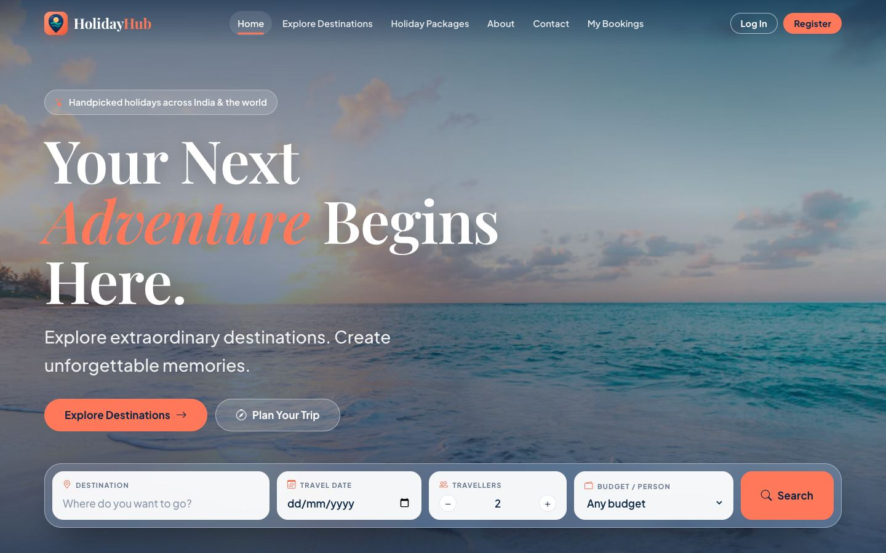
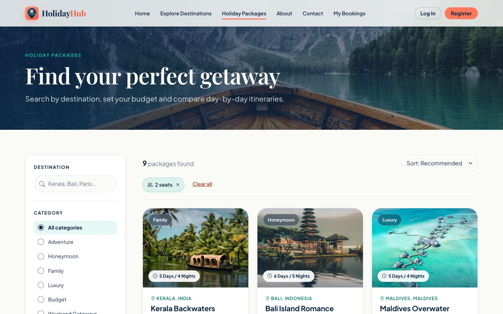
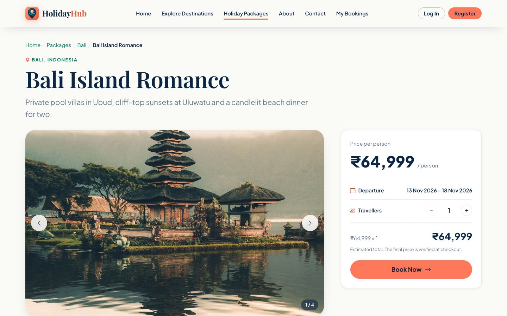
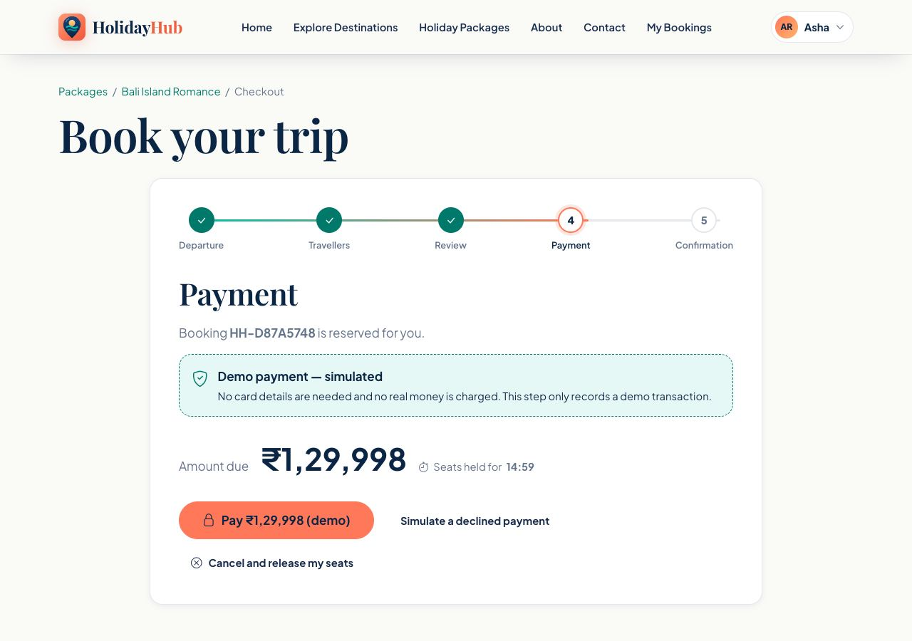
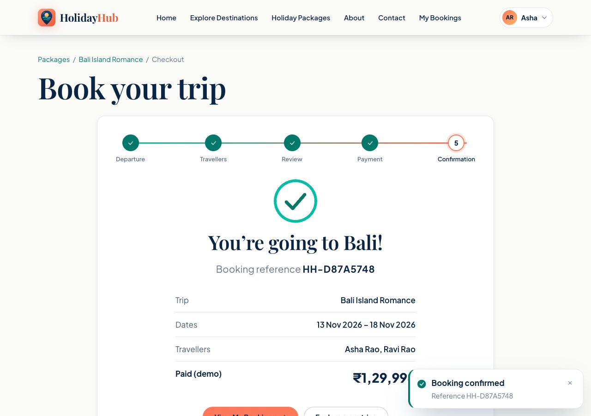
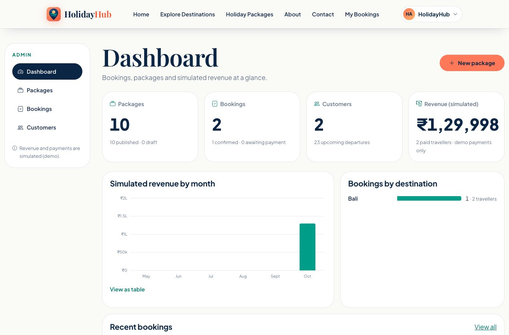
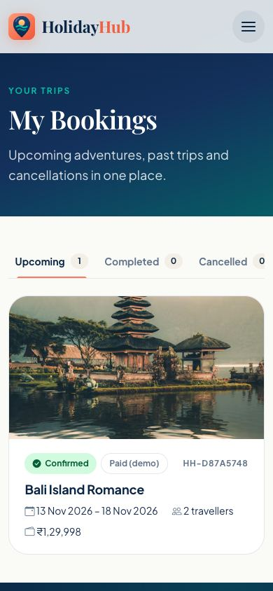

# HolidayHub

**Your Next Adventure Begins Here.** HolidayHub is a full-stack tours and holiday-package booking platform built on the MERN stack (MongoDB, Express, React, Node.js). Visitors can discover destinations and compare day-by-day itineraries. Customers can reserve seats on scheduled departures and complete a **simulated** checkout. Administrators manage the catalogue, departures, capacity and bookings from a dedicated dashboard.

The project was developed as a Full Stack Development course project. It is meant to show a complete, working application flow, from the user interface through the REST API to persistent storage, with attention to correctness, security, accessibility and visual quality.

> **Disclaimer.** HolidayHub is an academic demonstration and not a registered tour operator. Packages, prices and sample stories are illustrative. **All payments are simulated**: no card details are collected and no money is transferred.



---

## Table of contents

1. [Features](#1-features)
2. [Screenshots](#2-screenshots)
3. [Technology stack](#3-technology-stack)
4. [System architecture](#4-system-architecture)
5. [Repository structure](#5-repository-structure)
6. [Getting started](#6-getting-started)
7. [Configuration](#7-configuration)
8. [Available scripts](#8-available-scripts)
9. [Using the application](#9-using-the-application)
10. [Data model](#10-data-model)
11. [REST API overview](#11-rest-api-overview)
12. [Booking and payment design](#12-booking-and-payment-design)
13. [Security](#13-security)
14. [Accessibility and performance](#14-accessibility-and-performance)
15. [Design system](#15-design-system)
16. [Testing and quality assurance](#16-testing-and-quality-assurance)
17. [Deployment](#17-deployment)
18. [Version control workflow](#18-version-control-workflow)
19. [Course syllabus coverage](#19-course-syllabus-coverage)
20. [Known limitations and future work](#20-known-limitations-and-future-work)
21. [Further documentation](#21-further-documentation)
22. [Credits](#22-credits)

---

## 1. Features

### 1.1 Visitors and customers

| Area | Capabilities |
|---|---|
| **Discovery** | Full-screen homepage hero with a glass-style search widget (destination, date, travellers, budget); a grid of popular destinations; featured packages you can filter by category; travel-inspiration themes. |
| **Search** | Package listing with filters for destination, category, budget, trip length, departure date and seats required, plus sorting. All filters live in the URL, so results can be shared and survive a page refresh. |
| **Package details** | Photo gallery (swipe, arrow keys, thumbnails), an animated day-by-day itinerary, inclusions and exclusions, a departure selector with live seat counts, and a price summary that updates as you change the number of travellers. |
| **Accounts** | Registration and login with live validation and a password-strength indicator. Sessions use secure cookies, and profile details can be edited. |
| **Checkout** | Five steps: confirm the departure → enter traveller details → review the server-verified price → **demo payment** → confirmation with a booking reference. Seats are held for 15 minutes while you pay. |
| **My Bookings** | Upcoming, completed and cancelled tabs; booking details with payment history; self-service cancellation under a documented policy (with a demo refund). |
| **Contact** | A validated contact form whose messages are stored in the database. |

### 1.2 Administrators

| Area | Capabilities |
|---|---|
| **Dashboard** | Totals for packages, bookings and customers; simulated revenue; monthly revenue chart; bookings by destination; recent bookings. |
| **Packages** | Create, edit, publish and archive packages, with an editor for the gallery, itinerary, inclusions and exclusions. A package with bookings is archived rather than deleted. |
| **Departures** | Schedule departures and set capacity and optional peak-season pricing. Capacity can never be reduced below the number of seats already sold. |
| **Bookings** | Search and filter all bookings (reference, customer, trip, status, date range) and apply only valid status changes (cancel or complete). |
| **Customers** | List of customer accounts with search. Only basic, non-sensitive fields are shown. |

### 1.3 Platform qualities

- Seats are reserved with a single atomic database update, so departures **cannot be oversold**, even when many requests arrive at once.
- **Idempotent** bookings and payments: retried requests never create duplicate bookings or charges.
- Every input is validated on the server, responses use one consistent JSON format, and errors are handled centrally.
- Passwords are hashed with bcrypt. Sessions use **HttpOnly, SameSite cookies**. Admin permissions are enforced on the server, requests from other websites are rejected (CSRF protection), and sensitive endpoints are rate-limited.
- **Accessibility:** WCAG 2.1 AA, verified with axe-core across all user roles at desktop and mobile widths. The site works with the keyboard and with screen readers, and honours the system "reduce motion" setting.
- Responsive layouts verified at 360 px, 768 px and desktop widths.

---

## 2. Screenshots

| Package listing | Package details |
|---|---|
|  |  |

| Demo payment step | Booking confirmation |
|---|---|
|  |  |

| Administrator dashboard | Mobile views |
|---|---|
|  |   |

---

## 3. Technology stack

| Layer | Technology | Purpose |
|---|---|---|
| Front end | **React 19**, **Vite 8** | Component-based single-page application and build tooling |
| Routing | **React Router 7** | Client-side routing, protected routes, pages loaded on demand |
| Styling | **Bootstrap 5.3** (Sass; only the modules in use), custom CSS design tokens, **Bootstrap Icons** | Responsive grid, form controls, utilities; branded visual system |
| Motion | **Motion for React 12** | Page transitions, scroll reveals, accordions, step transitions |
| State | React Context API, custom hooks | Login session, notifications, data loading, forms |
| Back end | **Node.js 22**, **Express 5** | REST API and middleware |
| Database | **MongoDB** (Atlas), **Mongoose 9** | Schemas, validation, indexes, aggregations |
| Validation | **Zod 4** | Checking every request's query, parameters and body |
| Security | bcryptjs, jsonwebtoken, Helmet, CORS, cookie-parser | Password hashing, signed sessions, security headers |
| Testing | **Vitest 5**, React Testing Library, Supertest, mongodb-memory-server | Unit, component and API integration tests |
| Quality | ESLint 10, axe-core, GitHub Actions | Linting, accessibility auditing, continuous integration |
| Hosting (target) | Vercel (web), Render (API), MongoDB Atlas (database) | See [Deployment](#17-deployment) |

---

## 4. System architecture

```
┌─────────────────────────┐      /api/*       ┌──────────────────────────┐      ┌─────────────────┐
│  React SPA (Vite)       │ ───────────────►  │  Express REST API        │ ───► │  MongoDB Atlas  │
│  • Pages & components   │   same-origin     │  • Validation (Zod)      │      │  • users        │
│  • Auth/Toast context   │   proxy/rewrite   │  • Auth & roles          │      │  • packages     │
│  • services/ (fetch)    │ ◄───────────────  │  • Services (business    │ ◄─── │  • departures   │
│                         │   JSON envelope   │    logic)                │      │  • bookings     │
└─────────────────────────┘   + session cookie└──────────────────────────┘      │  • payments     │
                                                                                │  • contacts     │
                                                                                └─────────────────┘
```

**Request flow.** Pages call service modules (`client/src/services`) that wrap `fetch`. Each response arrives in a standard envelope; failures become a typed `ApiError` with a status code and per-field details. On the server, every route runs through validation middleware, then authentication and role checks where needed, then a controller. Controllers delegate to service modules that contain the business rules (availability, reservations, payments, administration).

**Single origin.** In development, Vite forwards `/api` requests to Express. In production, Vercel forwards `/api` to the API host. The browser therefore always talks to a single origin, which keeps the HttpOnly session cookie first-party (avoiding third-party-cookie blocking) and keeps CSRF protection simple.

---

## 5. Repository structure

```text
HolidayHub/
├── client/                      React single-page application
│   ├── public/                  favicon, robots.txt
│   ├── src/
│   │   ├── components/          layout · ui · travel · package · booking · auth · admin · home
│   │   ├── context/             AuthProvider, ToastProvider
│   │   ├── hooks/               useAsync, useForm, useModalBehavior, …
│   │   ├── pages/               route pages (incl. pages/admin)
│   │   ├── services/            HTTP client and API modules
│   │   ├── styles/              design tokens, Bootstrap subset, global styles
│   │   ├── utils/               search state, dates, formatting, redirects
│   │   └── test/                test setup, fixtures and helpers
│   ├── vercel.json              hosting: SPA fallback, /api rewrite, headers
│   └── vite.config.js           build, dev proxy and test configuration
├── server/                      Express REST API
│   ├── src/
│   │   ├── config/              validated environment, database connection
│   │   ├── models/              Mongoose schemas
│   │   ├── validators/          Zod request schemas
│   │   ├── middleware/          validation, auth, origin guard, rate limit, errors
│   │   ├── services/            catalogue, auth, booking and admin business logic
│   │   ├── controllers/ routes/ HTTP layer
│   │   ├── seed/                demo data and seed scripts
│   │   └── app.js               Express application
│   ├── test/                    API integration tests
│   └── server.js                entry point
├── docs/                        architecture, API, security, testing, deployment, screenshots
├── .github/workflows/ci.yml     continuous integration
└── render.yaml                  API hosting blueprint
```

A file-by-file description is available in [docs/architecture.md](docs/architecture.md).

---

## 6. Getting started

### 6.1 Prerequisites

| Requirement | Version |
|---|---|
| Node.js | 22.9 or later |
| npm | 10 or later |
| MongoDB | MongoDB Atlas cluster (free tier is sufficient) or a local MongoDB server |

### 6.2 Installation

```bash
git clone <repository-url> holidayhub
cd holidayhub

# API dependencies
cd server && npm install

# Web application dependencies
cd ../client && npm install
```

> Both `client/.npmrc` and `server/.npmrc` set `legacy-peer-deps=true`. This works around an npm 10 crash when resolving Vitest 5's peer dependencies; every required peer is listed explicitly in `package.json`.

### 6.3 Configure the API

```bash
cd server
cp .env.example .env
```

Edit `server/.env` and set at least `MONGODB_URI` and `JWT_SECRET` (see [Configuration](#7-configuration)). To generate a secure secret:

```bash
node -e "console.log(require('crypto').randomBytes(48).toString('hex'))"
```

### 6.4 Seed the database

```bash
npm run seed         # 10 demo packages and their departures (safe to run repeatedly)
npm run seed:admin   # creates the administrator from ADMIN_EMAIL / ADMIN_PASSWORD in .env
```

### 6.5 Run in development

Use two terminals:

```bash
# Terminal 1 — API on http://localhost:5050/api
cd server && npm run dev

# Terminal 2 — web app on http://localhost:5173
cd client && npm run dev
```

Open **http://localhost:5173**. The Vite development server forwards `/api` requests to the API.

### 6.6 Preview the production build locally

```bash
cd client
npm run build     # outputs client/dist
npm run preview   # serves the build on http://localhost:4173 (with the same /api proxy)
```

---

## 7. Configuration

### 7.1 API environment variables (`server/.env`)

| Variable | Required | Default | Description |
|---|:---:|---|---|
| `MONGODB_URI` | Yes | — | MongoDB connection string |
| `MONGODB_DB` | | `holidayhub` | Database name |
| `JWT_SECRET` | Yes | — | Session-signing secret, at least 32 characters. Production start-up fails if it still holds the example placeholder. |
| `PORT` | | `5050` | API port (5050 avoids the macOS AirPlay service, which uses 5000) |
| `NODE_ENV` | | `development` | `production` turns on secure cookies, hides internal error details and blocks destructive seeding |
| `CLIENT_ORIGIN` | | local dev and preview origins | Comma-separated list of allowed web origins (used for CORS and CSRF checks) |
| `SESSION_DAYS` | | `7` | How long a login session lasts (1–30 days) |
| `COOKIE_SAMESITE` | | `lax` | `lax` / `strict` / `none` (`none` requires `COOKIE_SECURE=true`) |
| `COOKIE_SECURE` | | `true` in production | Send the session cookie over HTTPS only |
| `TRUST_PROXY` | | `1` | Number of proxies in front of the API, so rate limits see each visitor's real IP address |
| `APP_TIMEZONE` | | `Asia/Kolkata` | Time zone used to decide what "today" is for departures |
| `ADMIN_NAME`, `ADMIN_EMAIL`, `ADMIN_PASSWORD` | Seed only | — | Read only by `npm run seed:admin` |

### 7.2 Web application variables (`client/.env`, optional)

| Variable | Default | Description |
|---|---|---|
| `VITE_API_URL` | `/api` | API base URL. Leave unset when `/api` is proxied (development and the recommended production setup). |

> `.env` files are excluded from version control. Never place secrets in `VITE_*` variables: they are embedded in the browser bundle.

---

## 8. Available scripts

| Command | Location | Description |
|---|---|---|
| `npm run dev` | server | Start the API with automatic restart on changes |
| `npm start` | server | Start the API (production) |
| `npm run seed` | server | Insert or update the demo catalogue; `npm run seed -- --reset` wipes and reseeds (refused in production) |
| `npm run seed:admin` | server | Create the administrator; `-- --reset-password` changes the password |
| `npm test` | server | API integration tests against an in-memory MongoDB |
| `npm run dev` | client | Development server with hot reloading |
| `npm run build` | client | Production build |
| `npm run preview` | client | Serve the production build locally |
| `npm test` | client | Unit and component tests |
| `npm run lint` | both | ESLint |

---

## 9. Using the application

### 9.1 Roles

| Role | How it is created | Access |
|---|---|---|
| Visitor | — | Browse destinations, search packages, view details |
| Customer | Self-registration at `/register` | Visitor access plus booking, demo payment, My Bookings and profile |
| Administrator | `npm run seed:admin` only (never via public registration) | Customer access plus `/admin` and every `/api/admin/*` endpoint |

No credentials are committed to the repository. Administrator credentials come from the local `.env` file at seeding time.

### 9.2 Customer journey

`Homepage → Search / Explore → Package details → Choose departure → Log in or register → Traveller details → Review price → Demo payment → Confirmation → My Bookings`

### 9.3 Administrator journey

`Log in → Dashboard → Create or edit a package → Publish → Add departures and capacity → Review bookings → Update booking status`

---

## 10. Data model

| Collection | Key fields | Notes |
|---|---|---|
| `users` | `name`, `email` (unique, lower-case), `passwordHash`, `phone?`, `role` | The hash is never returned by the API |
| `packages` | `slug` (unique), `title`, `destination`, `country`, `category`, `durationDays`, `basePrice`, `images[]`, `itinerary[]`, `inclusions[]`, `exclusions[]`, `tags[]`, `featured`, `status` | `draft` → `published` → `archived` |
| `departures` | `packageId`, `startDate`, `endDate`, `pricePerPerson?`, `capacity`, `seatsRemaining`, `status` | A validator ensures `seatsRemaining ≤ capacity` |
| `bookings` | `reference` (unique), `userId`, `packageId`, `departureId`, trip snapshot, `travellers[]`, `travellerCount`, `unitPriceSnapshot`, `totalAmount`, `bookingStatus`, `paymentStatus`, `idempotencyKey?`, `holdExpiresAt?` | Price and trip details are copied into the booking, so history survives later package edits |
| `payments` | `bookingId`, `amount`, `provider: "demo"`, `status`, `transactionReference` (unique) | A unique partial index allows at most one successful payment per booking |
| `contactmessages` | `name`, `email`, `subject?`, `message`, `status` | Stored contact-form submissions |

Indexes cover the common queries: packages by status and destination, category or price; departures by package and date; bookings by user and date; and the uniqueness of references, slugs and email addresses.

---

## 11. REST API overview

All endpoints are under `/api` and return a consistent envelope:

```json
{ "success": true,  "data": { } }
{ "success": false, "error": { "message": "Validation failed", "details": [{ "field": "email", "message": "…" }] } }
```

| Group | Endpoints | Access |
|---|---|---|
| Health | `GET /health` | Public |
| Catalogue | `GET /packages` (search, filter, sort, paginate) · `GET /packages/facets` · `GET /packages/:id` · `GET /packages/:id/departures` · `GET /packages/:id/related` · `GET /departures/:id` | Public |
| Contact | `POST /contact` | Public (rate-limited) |
| Authentication | `POST /auth/register` · `POST /auth/login` · `POST /auth/logout` · `GET /auth/me` | Public / session |
| Profile | `PATCH /users/me` | Customer, admin |
| Bookings | `POST /bookings/quote` · `POST /bookings` · `GET /bookings/my` · `GET /bookings/:id` · `PATCH /bookings/:id/cancel` | Owner (or admin) |
| Payments | `POST /payments/demo` | Booking owner |
| Administration | `GET /admin/stats` · `GET/POST /admin/packages` · `GET/PUT/DELETE /admin/packages/:id` · `GET/POST /admin/departures` · `PUT /admin/departures/:id` · `GET /admin/bookings` · `PATCH /admin/bookings/:id/status` · `GET /admin/users` | Admin |

Status codes: `400` validation, `401` not logged in, `403` not permitted or wrong origin, `404` not found (also used to hide other users' bookings), `409` conflict (for example, not enough seats), `429` rate-limited. Request and response details: [docs/api.md](docs/api.md).

---

## 12. Booking and payment design

### 12.1 Booking lifecycle

```
quote ─► reserve (POST /bookings) ─► pending / unpaid ── seats held for 15 minutes
                                        │          │                  │
                              demo payment      cancel           hold expires
                                        ▼          ▼                  ▼
                              confirmed / paid   cancelled      cancelled (hold expired)
                                        │
                     cancel ≥ 7 days before departure (or by an admin)
                                        ▼
                              cancelled / refunded (demo)
```

### 12.2 Consistency guarantees

- **No overselling.** Seats are taken with one conditional atomic update (`seatsRemaining ≥ n` → decrement by `n`). In the test suite, eight simultaneous requests for the last seat produce exactly one booking.
- **Server-authoritative pricing.** Totals are always computed on the server as `travellers × (departure price or package base price)`. Any price sent by the client is ignored.
- **Undo on failure.** If creating a booking fails after seats were reserved, those seats are returned. Expired holds and cancellations release seats exactly once, never above capacity.
- **Idempotency.** Checkout sends an idempotency key, so a repeated "reserve" request returns the original booking. A repeated payment request returns the original payment record.
- **Scope.** The design uses atomic single-document updates plus undo steps rather than multi-document transactions. This is a documented trade-off: an unexpected crash between two steps could leave a seat hold, which the expiry sweep (running every 60 seconds) later releases.

### 12.3 Cancellation policy (demonstration)

Customers may cancel a paid booking free of charge until **7 days before departure**, and may release an unpaid hold at any time. A paid booking that is cancelled receives a recorded demo refund, and its seats return to sale immediately. Administrators may cancel at any time, and may mark a confirmed trip as completed once it has started.

---

## 13. Security

| Concern | Measure |
|---|---|
| Passwords | bcrypt (cost 12); policy of 8–72 characters including a letter and a number |
| Sessions | Signed JWT in an `HttpOnly`, `SameSite=Lax` cookie (`Secure` in production); page scripts cannot read it |
| Login messages | The same message for an unknown email or a wrong password, and similar response times, so the form doesn't reveal which emails have accounts |
| Authorization | Roles are enforced on the server; the user and role are re-checked on every request, so role changes take effect immediately |
| Privilege escalation | Public registration always creates a customer; any `role` field in the request is discarded |
| CSRF | Requests that change data are rejected unless they come from an allowed origin; combined with SameSite cookies and strict CORS |
| Rate limiting | Login 10 per 15 minutes, registration 10 per hour and contact form 5 per 10 minutes, per IP address |
| Input handling | Zod validation on every request; search text is escaped before use in database queries; request bodies limited to 100 KB |
| Headers | Helmet on the API; `nosniff`, frame denial and referrer policy on the web host |
| Secrets | Held only in environment variables; `.env` files are never committed |

Full rationale: [docs/security.md](docs/security.md).

---

## 14. Accessibility and performance

**Accessibility**
- Audited with **axe-core** (WCAG 2.1 A/AA plus best practices) on 19 views across the visitor, customer and administrator roles, at 1280 px and 375 px: **0 violations**.
- Semantic landmarks and heading structure, a skip link, visible focus indicators, labelled form controls with linked error messages, and focus moved to the right place in dialogs, drawers and checkout steps.
- Keyboard support for the account menu, booking tabs, gallery, itinerary accordion, chart tooltips and scrollable tables.
- The system "reduce motion" setting is honoured: movement-based animation and parallax are turned off.
- Colour tokens meet AA contrast; every chart can also be viewed as a data table.

**Performance**
- Pages load on demand (code splitting), so the initial JavaScript is about 89 KB compressed.
- Bootstrap is compiled from Sass with only the modules in use, about 40 KB of compressed CSS in total.
- Images are lazy-loaded, sized responsively (`srcset`), and show a placeholder while loading and a fallback if they fail.
- Animations are driven by the GPU and scroll position rather than continuous JavaScript; the navbar's scroll handling is throttled.

---

## 15. Design system

| Token | Value | Usage |
|---|---|---|
| Deep Ocean | `#0B2545` | Primary text, headings, dark surfaces |
| Tropical Teal | `#00BFA6` (text: `#00796B`) | Accents, success states |
| Sunset Coral | `#FF785A` (text: `#B9401F`) | Primary actions, highlights |
| Warm Off-White | `#FAFAF7` | Page background |
| Typography | Plus Jakarta Sans (interface), Playfair Display (display) | Type sizes scale fluidly with the screen using `clamp()` |

Reusable components include `Button`, `Chip`, `TextField`, `PasswordField`, `Stepper`, `Drawer`, `ConfirmDialog`, toast notifications, `Skeleton`, `EmptyState`, `SmartImage` and `TableScroll`. Details: [docs/architecture.md](docs/architecture.md#design-system).

---

## 16. Testing and quality assurance

| Suite | Tests | Scope |
|---|:---:|---|
| API (`server/test`) | 65 | Catalogue filters, authentication, authorization, bookings, concurrency, payments, cancellation, administration, contact. Runs against a real in-memory MongoDB. |
| Web (`client/src`) | 76 | Utilities, HTTP client, search, details, checkout, My Bookings, authentication, routing, administration, forms, error states |
| **Total** | **141** | |

```bash
cd server && npm test
cd client && npm test
```

Every required test scenario maps to an automated test (see [docs/testing.md](docs/testing.md)). The complete demonstration was also run end to end in a real browser against MongoDB Atlas: an administrator creates and publishes a package and adds a departure; a customer searches, books and pays (demo); the administrator then updates the booking's status.

**Continuous integration.** [`.github/workflows/ci.yml`](.github/workflows/ci.yml) runs linting, tests and the production build for both applications on every push and pull request.

---

## 17. Deployment

Recommended setup: **Vercel** (web application) → `/api` rewrite → **Render** (API) → **MongoDB Atlas**.

1. Create a MongoDB Atlas database user and allow access from the API host.
2. Deploy the API on Render using [`render.yaml`](render.yaml); set `MONGODB_URI` and `CLIENT_ORIGIN` (the session secret is generated by Render).
3. Seed the database from the Render shell (`npm run seed`, `npm run seed:admin`).
4. Import the repository into Vercel with the root directory set to `client`. [`client/vercel.json`](client/vercel.json) handles client-side routing, the API rewrite, caching and security headers.

Step-by-step instructions and the production checklist: [docs/deployment.md](docs/deployment.md).

---

## 18. Version control workflow

| Branch | Purpose |
|---|---|
| `main` | Released versions (tagged, e.g. `v1.0.0`) |
| `develop` | Integration branch |
| `feature/*` | One branch per development phase (`packages`, `api`, `auth`, `booking`, `admin`, `polish`), merged into `develop` with `--no-ff` |

Commits follow the conventional `type: summary` style (`feat:`, `chore:`).

---

## 19. Course syllabus coverage

| Course unit | Where it is demonstrated |
|---|---|
| HTML, CSS, JavaScript (ES6+) | Semantic markup, responsive Bootstrap grid and utilities, custom CSS design tokens, DOM events, client-side form validation |
| React | Function components and JSX, props and state, hooks (including custom hooks), Context API, React Router with protected and nested routes, API integration |
| Node.js and Express | npm modules, server setup, modular routers, middleware (validation, authentication, rate limiting, error handling), REST design |
| MongoDB integration | Mongoose schemas and validation, indexes, CRUD operations, aggregation pipelines, atomic updates, async/await, authentication and security |
| Git and deployment | Branching and merging workflow, environment variables, CI pipeline, hosting configuration for Vercel and Render |

---

## 20. Known limitations and future work

**Limitations**
- Payments are simulated; there is no real payment provider.
- Rate limiting and the seat-hold sweep run inside the API process. Running several API servers would need a shared store such as Redis.
- Sessions can't be revoked early on the server; they stay valid until they expire.
- Free hosting tiers may sleep when idle, so the first request after a pause can be slow.

**Possible enhancements**
- Wishlists, verified post-trip reviews, destination maps
- Printable booking receipts and email confirmations through a real provider
- Promotional codes and seasonal offers
- Integration with a hosted, compliant payment provider

---

## 21. Further documentation

| Document | Contents |
|---|---|
| [docs/architecture.md](docs/architecture.md) | Detailed file tree, design system, data access, development phases |
| [docs/api.md](docs/api.md) | Endpoint reference, query parameters, booking lifecycle |
| [docs/security.md](docs/security.md) | Sessions, CSRF, authorization, booking consistency, secrets |
| [docs/testing.md](docs/testing.md) | Test commands, scenario-to-test mapping, demonstration script |
| [docs/deployment.md](docs/deployment.md) | Production setup on Vercel, Render and MongoDB Atlas |

---

## 22. Credits

- Photography: [Unsplash](https://unsplash.com/license), used under the Unsplash License
- Icons: [Bootstrap Icons](https://icons.getbootstrap.com/) (MIT License)
- Fonts: Plus Jakarta Sans and Playfair Display via [Google Fonts](https://fonts.google.com/) (SIL Open Font License)

**Author:** Nitheeswaran, Full Stack Development course project.

This repository is academic coursework; no open-source licence has been applied.
